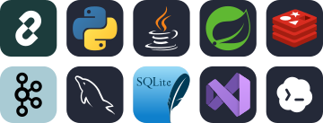

  

  
  
  

---

## 👋 About me

嗨，我是 **Quanlong**，关注 **AI 应用开发、后端开发与 Agent 工程实践** 👋

我喜欢从具体业务场景的痛点出发，探索 AI 的落地解法。我的核心关注点是探索新的开发流程和用AI重新定义软件，切实为用户创造价值。

这里记录我的技术探索、代码实践与持续迭代。欢迎聊实现、聊取舍，也欢迎一起把有意思的想法做出来。

## 🛠️ Tech Stack

  

我的技术栈与开发工具，按用途整理。

| 方向 | 技术与工具 |
| :--- | :--- |
| **AI 与 Agent** | `LangChain` |
| **语言** | `Python` · `Java` |
| **后端框架** | `Spring Boot` · `Flask API` · `Springcloud` |
| **中间件** | `Redis` · `Kafka` |
| **数据库** | `MySQL` · `SQLite` |
| **开发工具** | `Visual Studio` · `Codex` |

---

## 📫 Let's connect

欢迎交流 AI 应用、Agent 工作流与后端开发，也欢迎聊聊合适的工作机会。

可以通过 [GitHub](https://github.com/QuanLong427) 了解我的代码，在相关仓库的 Issue 中讨论具体问题。

[GitHub](https://github.com/QuanLong427) · [Email：zql7377@163.com](mailto:zql7377@163.com)

---

坚持做好每一件事 · welcome to reach out!

<!-- 确定代表项目后，在 Let's connect 之前添加 Spotlight。 -->
